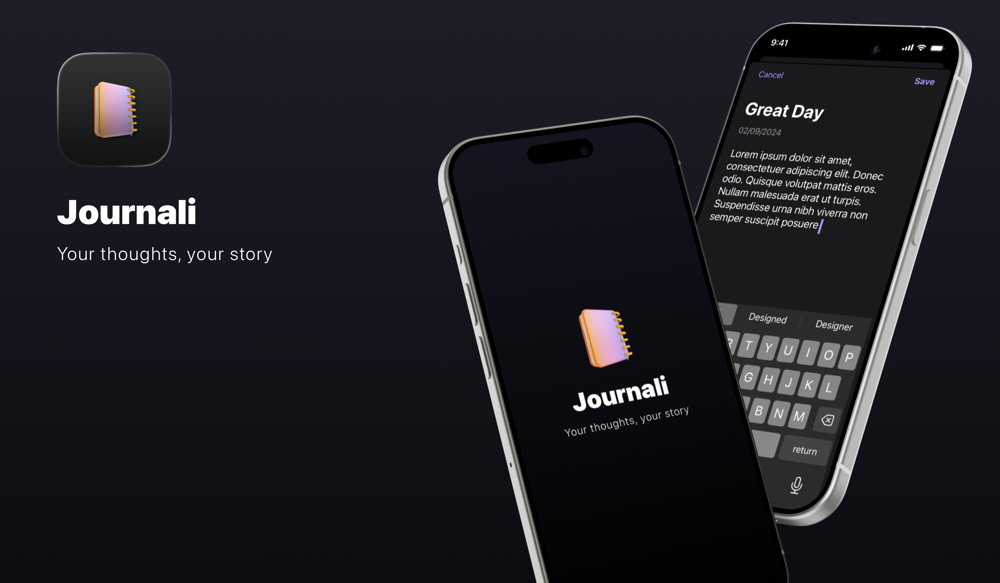

# Journali 📔

A simple journaling app for iOS built with **SwiftUI** and **SwiftData**.

## Features
- Create a journal with a title and content
- Edit a journal by tapping its card
- Delete a journal by swiping the card left, with a confirmation alert
- Bookmark journals
- Search journals by title or content
- Sort by bookmark or entry date
- Discard alert when closing the editor with unsaved changes
- Splash screen on launch
- Data is saved on the device (persists after closing the app)
- Supports Light and Dark mode (follows the phone's appearance)

## Tech
- SwiftUI
- SwiftData (persistence)
- MVVM (`@Observable` ViewModel)
- SF Symbols

## Project Structure
- **Theme**: colors, fonts, and spacing in one place
- **Models**: `Journal` (SwiftData model) and `JournalViewModel`
- **Views**: `MainView`, `EditJournalView`, `JournalListView`, `EmptyStateView`, `SplashView`
- **Components**: `JournalCard`, `SearchBar`, `HeaderButtons`, `PrimaryButton`, `CustomAlert`

## How to Run
1. Clone the repo
2. Open `JournalApp.xcodeproj` in Xcode
3. Choose an iPhone simulator and press **Cmd+R**

## Author
Norah Alosaimi
